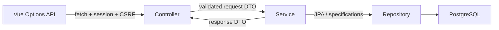
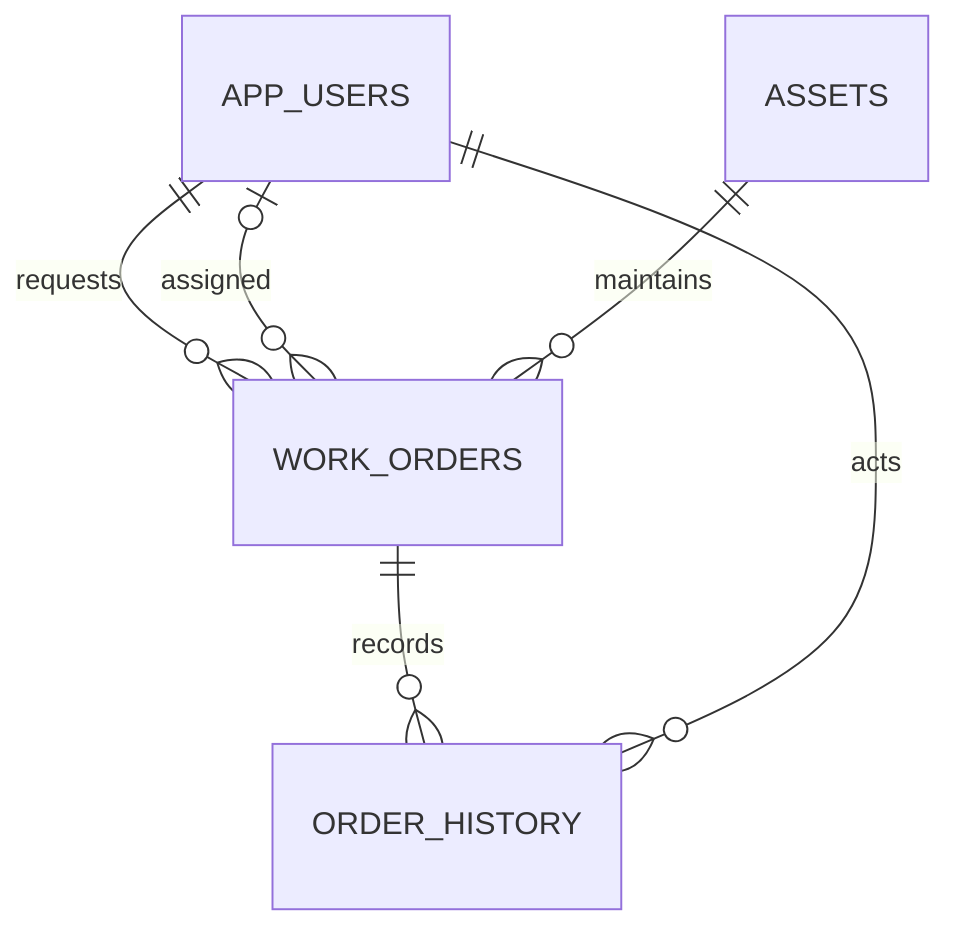

# Architecture

AssetCare is one Spring Boot deployment plus PostgreSQL. Vue is compiled into the application's static resources. There is no separate production frontend server.

## Responsibilities and folders

- `frontend/src/views`: screen state, forms, permitted action controls and API calls. `components` contains reusable badge, error and pagination displays.
- `frontend/src/api.js`: same-origin fetch and session/CSRF lifecycle. `router.js` uses hash routes and coarse navigation guards. Those guards are usability checks, not security boundaries.
- `web`: HTTP routes, request IDs and JSON error handling. Controllers validate DTOs and call services.
- `dto`: request validation and response shapes. Password hashes never enter responses. Plain Java classes and explicit constructors/accessors keep mapping visible.
- `service`: record permissions, state transitions, date rules, transactions and DTO loading.
- `repository`: database persistence through Spring Data JPA and specification queries.
- `model`: JPA entities/enums, relationships and version columns.
- `config`: security, UTC Clock and opt-in development seed.
- `src/main/resources/db/migration`: Flyway SQL is the schema source of truth. Hibernate `validate` detects mismatches.

## Relationships

Every work order has one asset and requester; its technician can be null. Every history entry has an order, actor, change kind, old/new value and UTC creation time. References are foreign keys without cascading deletes. No delete API exists. Asset code is unique after uppercase normalization. Database check constraints validate enums and completion data. Composite indexes support order access by requester/technician, asset/status and status/due date. History is indexed by order and ID. These indexes do not solve arbitrary text substring search.

## A complete request

1. `OrderForm.vue` collects an asset, title, description, priority and optional due date.
2. `api()` serializes JSON and adds the CSRF header and same-origin session cookie.
3. Spring Security authenticates the session and validates CSRF before controller execution.
4. `WorkOrderController.create()` applies Jakarta Bean Validation to `OrderInput`.
5. `WorkOrderService.create()` resolves the current user, rejects technicians, locks the asset row and checks that it is not retired.
6. The service sets OPEN, requester and UTC timestamps, saves the order and a STATUS history entry inside one transaction.
7. `OrderView` reads explicitly required fields inside the transaction and the controller returns 201 JSON.
8. The frontend navigates to the detail page, which loads permitted details and history.

## Authentication, authorization and CSRF

`SecurityConfig.userDetailsService()` loads a username and BCrypt hash from PostgreSQL. Spring's form-login filter authenticates `application/x-www-form-urlencoded` credentials at `/api/auth/login`; success returns 204 with a server session. Spring rotates the session ID to resist fixation. There is no public registration or role-selection endpoint.

The frontend first GETs `/api/auth/csrf`, which forces creation of the session-backed token. It sends the returned `headerName` and `token` on every POST/PUT. Authentication clears the previous CSRF token, so the client fetches a new one after login. Logout is a CSRF-protected POST, invalidates the session and removes JSESSIONID. Passwords are only sent to login and not stored in localStorage. Session cookies are HttpOnly/SameSite=Lax and must be Secure on HTTPS.

Security returns JSON 401 for an unauthenticated protected GET, 401 for invalid credentials, and 403 for denied actions or invalid/missing CSRF. An unsafe anonymous request without CSRF can return 403 before authentication; that is expected CSRF filter behavior. Controllers do not trust client-supplied requester/role fields. Services always obtain the actor from `CurrentUser` and enforce admin/assigned-technician/requester access. Technicians see assigned orders only, even if they once had access before reassignment. Viewers see only requests whose requester ID is theirs. History and dashboard use the same visibility policy. All roles can read the whole asset catalogue.

## Transactions and concurrent changes

Service writes use `@Transactional`; order changes and their history either both commit or both roll back. Read methods use read-only transactions and build DTOs before returning; OSIV is disabled. Associations remain lazy and are accessed deliberately by DTO constructors. This is straightforward but can cause extra selects on lists; query projections/entity graphs are a possible optimization, not an implemented claim.

Assets and orders have `@Version`. Update/retire/assignment/status requests carry the last displayed version. `Problem.checkVersion()` rejects an already stale request. Hibernate's version check also detects a competing transaction that commits after the application check. Explicit flushes surface conflicts inside the service call. The error handler maps optimistic-lock failures to HTTP 409/STALE_UPDATE. The UI keeps local inputs and tells the user to reload/review before retrying. No silent last-write-wins or automatic mutation replay is used.

Version checks alone do not prevent a new order from being created at the same time another request retires its asset, because those writes affect different rows. Both paths therefore use `AssetRepository.findForUpdate()` (a PostgreSQL row lock) on the parent asset before checking its status/active orders. Whichever gets the lock second sees the committed result of the first. Ordinary asset updates share that lock. Work-order transitions never add active orders; therefore they cannot introduce an active order after retirement has checked. These locking guarantees are implemented but need the skipped PostgreSQL tests plus a live concurrency exercise before a real release.

## Time, errors and operations

The injected Clock is UTC. `Instant` values serialize with UTC offsets; PostgreSQL uses `TIMESTAMP WITH TIME ZONE`. Date-only due dates use the UTC calendar and are overdue strictly before today for OPEN/IN_PROGRESS orders. Tests replace Clock with a fixed instant.

Every request gets a server-generated UUID in `X-Request-ID`; clients cannot inject it into logs. API errors contain `code`, `message`, `fieldErrors` and `requestId`. Validation is 400; record absence 404; business-rule/data/stale conflicts 409. SLF4J logs method, response status and request ID, with only exception type for unexpected failures. No bodies, descriptions, passwords or cookies are logged by application code.

Only minimal Actuator health endpoints are public. Health details are hidden. Readiness includes database connectivity; liveness excludes database availability to avoid restarting a healthy process just because PostgreSQL is down. Sessions are in process memory, so one replica is documented. Scaling requires a reviewed session strategy; it is not part of this project.
